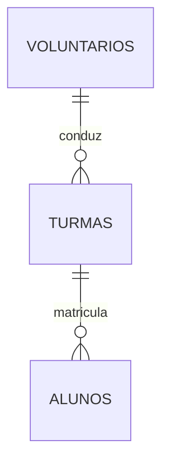

# EduConecta — Cadastro de Alunos para Reforço Escolar Gratuito

Prova de Conceito (PoC) desenvolvida para a Atividade de Estudo Programada (AEP) de
Engenharia de Software — UniCesumar, 6º semestre (2026.2). API REST documentada e
testável via **Swagger UI**, sem front-end nesta entrega.

## 1. Problema

Crianças e adolescentes em situação de vulnerabilidade socioeconômica frequentemente
não têm acesso a apoio pedagógico fora do horário regular de aula. Para suprir essa
lacuna, ONGs e coletivos comunitários organizam programas de reforço escolar
gratuito, mas em geral controlam as inscrições em planilhas soltas ou de memória —
o que causa perda de histórico quando voluntários trocam, dificulta saber quantos
alunos estão ativos por turma/turno, e prejudica a prestação de contas a financiadores.

O **EduConecta** ataca esse problema operacional com uma API para gerenciar alunos,
professores voluntários, turmas e matrículas de programas de reforço escolar gratuito
de forma centralizada e persistente.

## 2. ODS Atendido

**ODS 4 — Educação de Qualidade**, em especial as metas **4.1** (garantir ensino
primário/secundário gratuito e de qualidade) e **4.5** (eliminar disparidades de
acesso à educação para os mais vulneráveis). O EduConecta não substitui a ação
pedagógica dos voluntários — remove a barreira operacional que limita o alcance e a
continuidade desses programas.

## 3. Tecnologias Utilizadas

| Camada              | Tecnologia                                        |
|---------------------|-----------------------------------------------------|
| Linguagem           | Java 21 (LTS) — Programação Orientada a Objetos     |
| Framework REST      | Spring Boot 3.5                                     |
| Documentação da API | Swagger / OpenAPI (springdoc-openapi)               |
| Banco de dados      | MongoDB (Community Edition, local)                  |
| Driver MongoDB      | mongodb-driver-sync 5.5.1                           |
| Build               | Maven                                               |
| Testes              | JUnit 5 + Mockito + Spring MockMvc                  |
| Cobertura de testes | JaCoCo (mínimo de 70% configurado no `pom.xml`)     |

## 4. Escopo desta Entrega (2ª Entrega)

Evolução da primeira entrega (uma única coleção `alunos`) para o escopo do 2º semestre da AEP,
no banco `educonecta`:

- **Múltiplas coleções:** `alunos`, `voluntarios` e `turmas`.
- **Relacionamento entre coleções:** cada turma referencia o voluntário responsável e cada aluno
  referencia a turma em que está matriculado (`ObjectId`).
- **Objetos complexos:** o aluno guarda o `endereco` como subdocumento e os `responsaveis` como
  lista de subdocumentos.



```json
{
  "_id": "ObjectId(...)",
  "nome": "Maria Silva",
  "idade": 10,
  "curso": "Matematica",
  "turno": "Tarde",
  "ativo": true,
  "endereco": { "rua": "Rua das Flores, 120", "bairro": "Jardim Alvorada", "cidade": "Maringa", "estado": "PR" },
  "responsaveis": [ { "nome": "Ana Souza", "parentesco": "Mae", "telefone": "44999991234" } ],
  "turmaId": "ObjectId(...)"
}
```

Campos, tipos, índices e decisões de modelagem de todas as coleções estão na
[documentação técnica](docs/DOCUMENTACAO_TECNICA.md#3-modelagem-do-banco-de-dados-mongodb).

## 5. Como Executar

**Pré-requisitos:** Java 21, Maven 3.9+ e MongoDB Community Edition rodando em
`localhost:27017` (opcionalmente visualizável pelo MongoDB Compass).

```bash
mvn clean package
java -jar target/educonecta-poc.jar
```

Ou direto pela IDE: rode a classe `EduConectaApplication`. Com a API no ar, acesse:

```
http://localhost:8080/swagger-ui.html
```

Recursos disponíveis (CRUD completo nos três primeiros; 18 endpoints no total):

| Recurso      | Endpoint base                    | O que faz                                          |
|--------------|-----------------------------------|-----------------------------------------------------|
| Alunos       | `/api/alunos`                     | Cadastro de alunos, com endereço e responsáveis     |
| Voluntários  | `/api/voluntarios`                | Professores voluntários e suas disciplinas          |
| Turmas       | `/api/turmas`                     | Turmas de reforço, cada uma com um voluntário       |
| Matrículas   | `/api/turmas/{turmaId}/alunos`    | Lista, matricula (`POST .../{alunoId}`) e desmatricula (`DELETE .../{alunoId}`) |

Basta abrir cada endpoint no Swagger, clicar em **"Try it out"** e **"Execute"** —
os campos já vêm com exemplo preenchido. A ordem sugerida para testar (voluntário → turma →
aluno → matrícula) e as regras de negócio estão na documentação técnica.

## 6. Como Rodar os Testes e Gerar o Relatório de Cobertura

Os testes são automatizados e **não exigem** MongoDB em execução (banco mockado com
Mockito; API testada com MockMvc).

```bash
mvn clean verify
```

Executa os testes, gera o relatório em `target/site/jacoco/index.html` e **falha o
build automaticamente** se a cobertura ficar abaixo de 70% (regra no `pom.xml`). A cobertura é
medida sobre **todo** o código-fonte, sem exclusões.

Para validar o fluxo completo contra um MongoDB real, há o script
[`scripts/teste-e2e.ps1`](scripts/teste-e2e.ps1) (instruções no cabeçalho do arquivo).

## 7. Documentação e Acompanhamento

- [Documentação técnica](docs/DOCUMENTACAO_TECNICA.md): arquitetura, estrutura do banco, regras de
  negócio, API, instalação, execução e testes.
- [Quadro de tarefas](docs/QUADRO_DE_TAREFAS.md): metodologia (Kanban) e cartões com os commits
  correspondentes.

## 8. Versão desta Entrega

Esta versão corresponde à **Segunda Entrega** da AEP (tag `entrega-2`). A primeira entrega
permanece identificada pela tag `entrega-1`.
