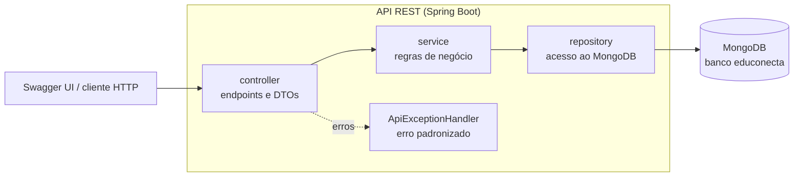
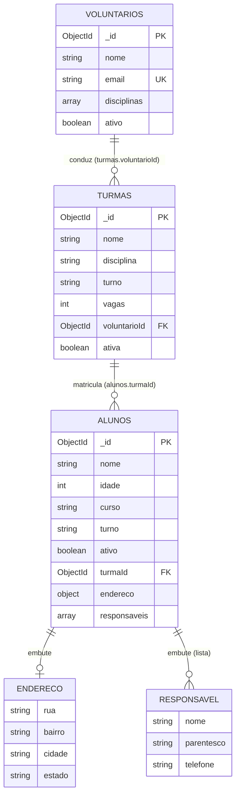

# EduConecta — Documentação Técnica

Documentação da PoC desenvolvida para a AEP de Engenharia de Software (UniCesumar, 6º semestre,
2026.2). Este documento complementa o [README](../README.md) e cobre arquitetura, modelagem do
banco de dados NoSQL, regras de negócio, API, instalação, execução e testes.

## Sumário

1. [Visão geral](#1-visão-geral)
2. [Arquitetura](#2-arquitetura)
3. [Modelagem do banco de dados (MongoDB)](#3-modelagem-do-banco-de-dados-mongodb)
4. [Regras de negócio](#4-regras-de-negócio)
5. [API REST](#5-api-rest)
6. [Instalação e execução](#6-instalação-e-execução)
7. [Testes e cobertura](#7-testes-e-cobertura)
8. [Evolução em relação à 1ª entrega](#8-evolução-em-relação-à-1ª-entrega)
9. [Estrutura do projeto](#9-estrutura-do-projeto)
10. [Limitações conhecidas](#10-limitações-conhecidas)

---

## 1. Visão geral

O **EduConecta** apoia a gestão de programas de reforço escolar gratuito (ODS 4 — Educação de
Qualidade). Substitui planilhas soltas por um cadastro centralizado e persistente de:

- **Alunos** — com endereço e responsáveis;
- **Voluntários** — professores e as disciplinas que lecionam;
- **Turmas** — cada uma conduzida por um voluntário e com número limitado de vagas;
- **Matrículas** — vínculo entre alunos e turmas, com validação de disciplina e vagas.

A interação é feita exclusivamente pela API REST, explorada pelo **Swagger UI**
(`http://localhost:8080/swagger-ui.html`); não há front-end.

## 2. Arquitetura

Aplicação Spring Boot em camadas, com dependências sempre em uma única direção:



| Camada | Pacote | Responsabilidade |
|---|---|---|
| Controller | `controller` | Recebe HTTP, converte DTO ↔ entidade, devolve o status correto. Não contém regra de negócio. |
| DTO | `dto` | Contratos de entrada/saída da API (records), documentados no Swagger. |
| Service | `service` | Regras de negócio e integridade entre coleções. |
| Repository | `repository` | Leitura/escrita no MongoDB e conversão entre `Document` e entidade. |
| Model | `model` | Entidades e objetos de valor, com validação de si mesmos. |
| Exception | `exception` | Exceções de negócio e tradução para respostas HTTP. |
| Config | `config` | Conexão com o MongoDB, índices e metadados do Swagger. |

**Aplicação dos conceitos de orientação a objetos**

- **Herança e generics:** todas as entidades estendem `Entidade` (id e igualdade); todos os
  repositórios estendem `MongoCrudRepository<T extends Entidade>`, que implementa o CRUD uma única
  vez. Cada repositório concreto informa só o nome da coleção e como converter entidade ↔ documento.
- **Encapsulamento:** as entidades validam seus próprios dados nos *setters* e construtores
  (`Aluno`, `Voluntario`, `Turma`); `Endereco` e `Responsavel` são *records* imutáveis que validam
  no construtor. Um objeto inválido nunca chega ao banco.
- **Responsabilidade única:** `AlunoService`, `VoluntarioService` e `TurmaService` cuidam de cada
  agregado; `MatriculaService` orquestra o relacionamento entre alunos e turmas.
- **Injeção de dependências:** todas as dependências entram pelo construtor, o que permite testar
  cada camada isolada com *mocks*.

**Dependências entre serviços** (sem ciclos):
`MatriculaService → AlunoService, TurmaService` · `TurmaService → VoluntarioService, AlunoService` ·
`VoluntarioService → TurmaRepository` (somente para verificar vínculos antes de remover).

## 3. Modelagem do banco de dados (MongoDB)

Banco `educonecta`, com **3 coleções**, **2 relacionamentos entre coleções** e **objetos complexos**
(subdocumento e lista de subdocumentos).



### 3.1 Coleção `alunos`

| Campo | Tipo | Obrigatório | Observação |
|---|---|---|---|
| `_id` | ObjectId | sim | Gerado pelo MongoDB |
| `nome` | string | sim | |
| `idade` | int | sim | 6 a 120 (mínimo de 6 para ingressar no programa) |
| `curso` | string | sim | Disciplina de reforço desejada |
| `turno` | string | sim | |
| `ativo` | boolean | sim | Padrão `true` |
| `endereco` | **subdocumento** | não | `rua`, `bairro`, `cidade`, `estado` (UF com 2 letras, gravada em maiúsculas) |
| `responsaveis` | **array de subdocumentos** | condicional | `nome`, `parentesco`, `telefone` (só dígitos). Obrigatório ao menos um para menores de 18 anos |
| `turmaId` | ObjectId (referência) | não | Turma em que o aluno está matriculado; ausente se não matriculado |

```json
{
  "_id": { "$oid": "6aeba0b3c6846d2a98444fd1" },
  "nome": "Maria Silva",
  "idade": 10,
  "curso": "Matematica",
  "turno": "Tarde",
  "ativo": true,
  "endereco": {
    "rua": "Rua das Flores, 120",
    "bairro": "Jardim Alvorada",
    "cidade": "Maringa",
    "estado": "PR"
  },
  "responsaveis": [
    { "nome": "Ana Souza", "parentesco": "Mae", "telefone": "44999991234" },
    { "nome": "Jose Silva", "parentesco": "Pai", "telefone": "4433221100" }
  ],
  "turmaId": { "$oid": "6aeba0b3c6846d2a98444fd0" }
}
```

### 3.2 Coleção `voluntarios`

| Campo | Tipo | Obrigatório | Observação |
|---|---|---|---|
| `_id` | ObjectId | sim | |
| `nome` | string | sim | |
| `email` | string | sim | Normalizado em minúsculas; **único** (índice único) |
| `disciplinas` | array de strings | sim | Ao menos uma; sem repetições (ignora maiúsculas) |
| `ativo` | boolean | sim | Padrão `true` |

```json
{
  "nome": "Carlos Pereira",
  "email": "carlos.pereira@email.com",
  "disciplinas": ["Matematica", "Fisica"],
  "ativo": true
}
```

### 3.3 Coleção `turmas`

| Campo | Tipo | Obrigatório | Observação |
|---|---|---|---|
| `_id` | ObjectId | sim | |
| `nome` | string | sim | |
| `disciplina` | string | sim | Precisa ser uma das disciplinas do voluntário |
| `turno` | string | sim | |
| `vagas` | int | sim | 1 a 100 |
| `voluntarioId` | ObjectId (referência) | sim | Voluntário responsável (coleção `voluntarios`) |
| `ativa` | boolean | sim | Padrão `true` |

```json
{
  "nome": "Matematica - Tarde A",
  "disciplina": "Matematica",
  "turno": "Tarde",
  "vagas": 15,
  "voluntarioId": { "$oid": "6aeba0b3c6846d2a98444fcf" },
  "ativa": true
}
```

### 3.4 Decisões de modelagem

| Decisão | Justificativa |
|---|---|
| **Endereço e responsáveis embutidos** no aluno | Pertencem a um único aluno, não têm ciclo de vida próprio, são sempre lidos junto com ele e têm tamanho limitado. Embutir evita *joins* e permite ler/gravar o aluno em uma só operação. |
| **Disciplinas embutidas** (array) no voluntário | Lista curta e sempre consultada com o voluntário. |
| **Turma e voluntário em coleções próprias** (referenciados) | Têm ciclo de vida independente e são compartilhados: um voluntário conduz várias turmas e uma turma reúne vários alunos. |
| **Referência no lado do aluno** (`alunos.turmaId`) e não uma lista de alunos dentro da turma | Relação 1 turma → N alunos: evita um array que cresce sem controle dentro do documento da turma. Listar e contar alunos de uma turma é uma consulta simples por `turmaId`. |
| **Referências como `ObjectId`** (não texto) | Tipo correto para junção com `_id` e uso de `$lookup`; os índices ficam mais compactos. |
| **Documentos antigos continuam legíveis** | A leitura trata campos ausentes (`endereco`, `responsaveis`, `turmaId`), então dados da 1ª entrega não quebram. |
| **Atualização por substituição** (`replaceOne`) | O PUT é substituição completa; não sobram campos antigos no documento. |

### 3.5 Índices

Criados automaticamente na inicialização (`MongoIndicesConfig`); uma falha apenas gera aviso e não
impede a API de subir.

| Coleção | Índice | Motivo |
|---|---|---|
| `voluntarios` | `email` **único** | Garante no banco que não existam dois voluntários com o mesmo e-mail |
| `turmas` | `voluntarioId` | Verificar se um voluntário possui turmas |
| `alunos` | `turmaId` | Listar e contar alunos de uma turma (checagem de vagas) |

### 3.6 Esquema na aplicação e integridade referencial

O MongoDB não impõe esquema nem chaves estrangeiras. Neste projeto:

- o **formato** dos documentos é garantido pelas entidades Java (validação na construção) e pelo
  mapeamento fixo em cada repositório;
- a **integridade referencial** é garantida pelos serviços (ver regras R09 a R13): não se cria turma
  com voluntário inexistente, não se remove turma com alunos nem voluntário com turmas.

Exemplo de consulta relacional (equivalente a um *join*) executada no `mongosh`:

```javascript
db.turmas.aggregate([
  { $lookup: { from: "voluntarios", localField: "voluntarioId", foreignField: "_id", as: "voluntario" } },
  { $lookup: { from: "alunos", localField: "_id", foreignField: "turmaId", as: "alunos" } },
  { $project: { _id: 0, nome: 1, vagas: 1, "voluntario.nome": 1, "alunos.nome": 1 } }
])
```

## 4. Regras de negócio

| # | Regra | Onde | Resposta |
|---|---|---|---|
| R01 | Aluno precisa ter no mínimo 6 anos — no cadastro **e na atualização** | `AlunoService` | 400 |
| R02 | Aluno menor de 18 anos exige ao menos um responsável | `AlunoService` | 400 |
| R03 | Aluno: nome, curso e turno obrigatórios; idade entre 0 e 120 | `Aluno` | 400 |
| R04 | Endereço: rua, bairro, cidade e UF (2 letras) obrigatórios | `Endereco` | 400 |
| R05 | Responsável: nome e parentesco obrigatórios; telefone com 10 ou 11 dígitos (guardado só com dígitos) | `Responsavel` | 400 |
| R06 | Voluntário: nome obrigatório, e-mail válido, ao menos uma disciplina | `Voluntario` | 400 |
| R07 | E-mail de voluntário é único (regra de serviço + índice único) | `VoluntarioService` | 409 |
| R08 | Turma: nome, disciplina e turno obrigatórios; vagas entre 1 e 100 | `Turma` | 400 |
| R09 | Voluntário da turma deve existir (404), estar ativo e lecionar a disciplina da turma (409) | `TurmaService` | 404 / 409 |
| R10 | Turma não pode ficar com menos vagas que alunos matriculados nem trocar de disciplina com alunos | `TurmaService` | 409 |
| R11 | Não é possível remover turma com alunos nem voluntário com turmas | `TurmaService`, `VoluntarioService` | 409 |
| R12 | Matrícula exige aluno e turma ativos, mesma disciplina (`aluno.curso` = `turma.disciplina`), vaga disponível e aluno ainda não matriculado nessa turma | `MatriculaService` | 409 |
| R13 | Aluno matriculado não pode trocar de disciplina (desmatricular antes) | `AlunoService` | 409 |
| R14 | Matricular um aluno que já está em outra turma o **transfere** para a nova | `MatriculaService` | 200 |

Observações:

- `PUT` é **substituição completa**; `ativo`/`ativa` omitidos valem `true`.
- Um `id` fora do formato de ObjectId (24 caracteres hexadecimais) retorna 400 com mensagem clara.
- O `turmaId` do aluno só muda pelos endpoints de matrícula; o `PUT` do aluno o preserva.

## 5. API REST

Documentação interativa: `http://localhost:8080/swagger-ui.html` · especificação OpenAPI:
`http://localhost:8080/v3/api-docs`.

| Recurso | Método | Endpoint | Sucesso | Erros possíveis |
|---|---|---|---|---|
| Alunos | POST | `/api/alunos` | 201 | 400 |
| | GET | `/api/alunos` | 200 | |
| | GET | `/api/alunos/{id}` | 200 | 400, 404 |
| | PUT | `/api/alunos/{id}` | 200 | 400, 404, 409 |
| | DELETE | `/api/alunos/{id}` | 204 | 400, 404 |
| Voluntários | POST | `/api/voluntarios` | 201 | 400, 409 |
| | GET | `/api/voluntarios` | 200 | |
| | GET | `/api/voluntarios/{id}` | 200 | 400, 404 |
| | PUT | `/api/voluntarios/{id}` | 200 | 400, 404, 409 |
| | DELETE | `/api/voluntarios/{id}` | 204 | 400, 404, 409 |
| Turmas | POST | `/api/turmas` | 201 | 400, 404, 409 |
| | GET | `/api/turmas` | 200 | |
| | GET | `/api/turmas/{id}` | 200 | 400, 404 |
| | PUT | `/api/turmas/{id}` | 200 | 400, 404, 409 |
| | DELETE | `/api/turmas/{id}` | 204 | 400, 404, 409 |
| Matrículas | GET | `/api/turmas/{turmaId}/alunos` | 200 | 400, 404 |
| | POST | `/api/turmas/{turmaId}/alunos/{alunoId}` | 200 | 400, 404, 409 |
| | DELETE | `/api/turmas/{turmaId}/alunos/{alunoId}` | 204 | 400, 404, 409 |

Todos os erros usam o mesmo formato (`ApiExceptionHandler`):

```json
{ "status": 409, "mensagem": "Turma sem vagas disponiveis." }
```

| Status | Quando |
|---|---|
| 400 | Dado inválido, corpo JSON ausente/mal formatado ou id fora do formato |
| 404 | Registro (ou referência informada) não encontrado |
| 409 | Regra de negócio violada em relação ao estado atual dos dados |
| 503 | Banco de dados indisponível (sem expor detalhes internos do driver) |

## 6. Instalação e execução

### 6.1 Pré-requisitos

| Item | Versão | Observação |
|---|---|---|
| JDK | 21 | Ex.: [Eclipse Temurin](https://adoptium.net/) |
| Maven | 3.9+ | Ou use a IDE (IntelliJ já traz o Maven) |
| MongoDB Community Server | testado com 8.3 | Em `localhost:27017`, sem autenticação. O MongoDB Compass é opcional, para visualizar os dados |

### 6.2 Passo a passo

1. **Garanta o MongoDB rodando.** No Windows ele costuma ser um serviço: `Get-Service MongoDB`.
2. **Obtenha o código** (`git clone` do repositório) e entre na pasta do projeto.
3. **Compile, teste e empacote:**
   ```bash
   mvn clean package
   ```
4. **Execute a API:**
   ```bash
   java -jar target/educonecta-poc.jar
   ```
   (ou rode a classe `EduConectaApplication` pela IDE). A API sobe em `http://localhost:8080`.
5. **Abra o Swagger:** `http://localhost:8080/swagger-ui.html`.

### 6.3 Configuração

Arquivo `src/main/resources/application.properties`:

| Propriedade | Padrão | Descrição |
|---|---|---|
| `server.port` | `8080` | Porta HTTP |
| `educonecta.mongodb.uri` | `mongodb://localhost:27017` | String de conexão do MongoDB |
| `educonecta.mongodb.database` | `educonecta` | Nome do banco |

Qualquer propriedade pode ser sobrescrita na execução, por exemplo para usar outro banco:

```bash
java -jar target/educonecta-poc.jar --educonecta.mongodb.database=educonecta_teste
```

### 6.4 Roteiro de teste manual no Swagger

Siga a ordem, copiando o `id` retornado em cada passo para o seguinte.

1. **POST `/api/voluntarios`** → `201`
   ```json
   { "nome": "Carlos Pereira", "email": "carlos.pereira@email.com", "disciplinas": ["Matematica", "Fisica"] }
   ```
2. **POST `/api/turmas`** → `201` (use o `id` do voluntário em `voluntarioId`)
   ```json
   { "nome": "Matematica - Tarde A", "disciplina": "Matematica", "turno": "Tarde", "vagas": 2, "voluntarioId": "<id do voluntario>" }
   ```
3. **POST `/api/alunos`** → `201`
   ```json
   {
     "nome": "Maria Silva", "idade": 10, "curso": "Matematica", "turno": "Tarde",
     "endereco": { "rua": "Rua das Flores, 120", "bairro": "Jardim Alvorada", "cidade": "Maringa", "estado": "PR" },
     "responsaveis": [ { "nome": "Ana Souza", "parentesco": "Mae", "telefone": "(44) 99999-1234" } ]
   }
   ```
4. **POST `/api/turmas/{turmaId}/alunos/{alunoId}`** → `200`; o aluno volta com o `turmaId` preenchido.
5. **GET `/api/turmas/{turmaId}/alunos`** → lista os alunos da turma.
6. Conferir as regras (todas devem falhar com o status indicado):
   - cadastrar aluno de 10 anos **sem** `responsaveis` → `400`;
   - cadastrar outro voluntário com o mesmo e-mail → `409`;
   - matricular um aluno de outra disciplina, ou além das vagas → `409`;
   - **DELETE** da turma com alunos matriculados → `409`.
7. **DELETE `/api/turmas/{turmaId}/alunos/{alunoId}`** → `204`, depois **DELETE** da turma → `204`.

Para ver os documentos no MongoDB Compass: banco `educonecta`, coleções `alunos`, `voluntarios` e `turmas`.

## 7. Testes e cobertura

### 7.1 Estratégia

Os testes automatizados **não exigem MongoDB**: o acesso ao banco é simulado (Mockito) e a API é
exercitada com `MockMvc`. Cada camada é testada isolada, e um teste de integração sobe o contexto
Spring completo.

| Camada | Técnica | Testes |
|---|---|---|
| `model` | JUnit 5 — validações, normalizações, igualdade | 49 |
| `repository` | Mockito simulando `MongoCollection`; confere o documento gravado (subdocumentos, `ObjectId`) e a leitura | 26 |
| `service` | Mockito simulando repositórios/serviços; todas as regras R01–R14 | 58 |
| `dto` | Conversão entidade ↔ DTO e valores padrão | 8 |
| `controller` | `MockMvc` standalone com serviço simulado: status HTTP, JSON e erros | 39 |
| `exception` | Tradução de cada exceção para a resposta HTTP padronizada | 6 |
| `config` | Índices, conexão e metadados do Swagger | 6 |
| Integração | `@SpringBootTest`: injeção de dependências, OpenAPI e erro padronizado no contexto completo | 3 |
| **Total** | | **195** |

### 7.2 Como reproduzir

```bash
mvn clean verify
```

O comando executa os testes, gera o relatório em `target/site/jacoco/index.html` e **falha o build**
se a cobertura de instruções ficar abaixo de **70%** (regra do JaCoCo no `pom.xml`). Ao final o Maven
imprime `All coverage checks have been met.`

### 7.3 Resultado medido

Cobertura sobre **todo** o código-fonte (nenhuma classe é excluída da medição):

| Pacote | Instruções | Ramos (branches) |
|---|---|---|
| `model` | 100% | 100% |
| `repository` | 100% | 100% |
| `service` | 100% | 100% |
| `dto` | 100% | 100% |
| `controller` | 100% | — |
| `exception` | 100% | — |
| `config` | 100% | 100% |
| raiz (`EduConectaApplication`) | 37,5% | — |
| **Total** | **99,8%** (2359 de 2364) | **100%** |

A única parte não coberta é o método `main` do bootstrap (5 instruções), que apenas inicia o Spring.

### 7.4 Validação ponta a ponta com MongoDB real

Testes com banco simulado não provam o comportamento real do MongoDB, então o script
[`scripts/teste-e2e.ps1`](../scripts/teste-e2e.ps1) percorre o fluxo completo contra um banco real
(45 verificações: cadastros, subdocumentos, referências, matrículas, integridade referencial, erros e
documento OpenAPI). Instruções de uso no cabeçalho do script — recomenda-se um banco descartável
(`--educonecta.mongodb.database=educonecta_e2e`).

## 8. Evolução em relação à 1ª entrega

| Aspecto | 1ª entrega | 2ª entrega |
|---|---|---|
| Coleções | 1 (`alunos`) | 3 (`alunos`, `voluntarios`, `turmas`) |
| Estrutura dos documentos | Planos e homogêneos | Subdocumento (`endereco`) e lista de subdocumentos (`responsaveis`) |
| Relacionamento entre coleções | Nenhum | `turmas.voluntarioId → voluntarios` e `alunos.turmaId → turmas` |
| Índices | Apenas `_id` | E-mail único e índices de referência |
| Endpoints | 5 | 18 |
| Regras de negócio | Idade mínima | 14 regras (R01–R14) com integridade referencial |
| Testes automatizados | 38 | 195 (incluindo integração com contexto Spring) |
| Cobertura (JaCoCo) | 99%, excluindo bootstrap/config | 99,8% sobre **todo** o código |

**Melhorias de qualidade de código** (refatoração da base existente):

- Repositório genérico `MongoCrudRepository<T>` e entidade base `Entidade` eliminaram o CRUD e a
  igualdade repetidos; validações de texto centralizadas em um único ponto.
- Exceções genéricas (`RecursoNaoEncontradoException`, `ConflitoException`) no lugar de uma exceção
  aninhada em um serviço específico.
- **Correção de falha:** a idade mínima só era validada no cadastro e podia ser burlada via `PUT`.
- Atualização passou a consultar o banco uma única vez (antes eram duas consultas redundantes).
- Mensagem de erro para `id` inválido não expõe mais texto interno do driver do MongoDB.
- Tratamento de corpo JSON inválido (400) e de banco indisponível (503) com o mesmo formato de erro.

## 9. Estrutura do projeto

```
src/main/java/br/com/educonecta/
├── EduConectaApplication.java        # ponto de entrada
├── config/                           # MongoConfig, MongoIndicesConfig, OpenApiConfig
├── controller/                       # Aluno, Voluntario, Turma e Matricula controllers
├── dto/                              # records de entrada/saída (Aluno*, Voluntario*, Turma*, Endereco, Responsavel)
├── exception/                        # ApiExceptionHandler, ErroResponse, exceções de negócio
├── model/                            # Entidade, Aluno, Voluntario, Turma, Endereco, Responsavel
├── repository/                       # MongoCrudRepository + um repositório por coleção
└── service/                          # Aluno, Voluntario, Turma e Matricula services
src/main/resources/application.properties
src/test/java/br/com/educonecta/      # espelha os pacotes acima (195 testes)
scripts/teste-e2e.ps1                 # validação ponta a ponta com MongoDB real
docs/                                 # esta documentação e o quadro de tarefas
```

## 10. Limitações conhecidas

- **Sem autenticação/autorização:** a API é aberta (adequado a uma PoC local).
- **Sem paginação:** as listagens retornam todos os registros.
- **Checagem de vagas não atômica:** duas matrículas simultâneas na última vaga poderiam ultrapassar o
  limite; resolver exigiria transação ou atualização condicional (o MongoDB local standalone não
  oferece transações).
- **Integridade referencial na aplicação:** alterações feitas diretamente no banco (fora da API) não
  passam pelas regras de negócio.
- **Exclusão definitiva:** não há exclusão lógica nem histórico de alterações.
